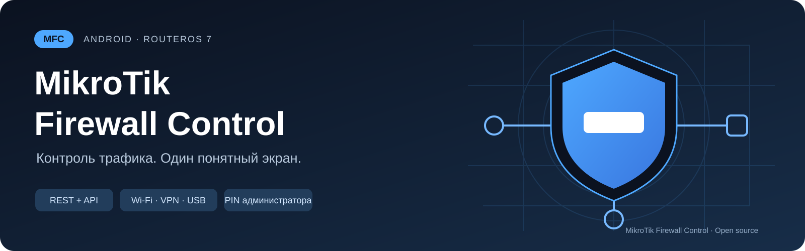

  
  
  
  
  

<h1 align="center">MikroTik Firewall Control</h1>

<strong>Администратор настраивает. Оператор останавливает. Администратор восстанавливает.</strong> В Android — <b>MFC</b>.

<a href="https://github.com/silikonoff/MikroTik-Firewall-Control/releases/download/v0.2.11/MikroTikFirewallControl-v0.2.11-debug.apk"><strong>↓ Скачать APK · 0.2.11</strong></a> · <a href="docs/SETUP.md">Настроить MikroTik</a> · <a href="docs/OPERATOR.md">Памятка оператору</a> · <a href="docs/FAQ.md">Помощь</a>

**MFC — Android-приложение для управления заранее подготовленными группами firewall-правил MikroTik.** Вместо списка технических правил оператор видит понятные карточки — например, **VPN** и **GUEST** — и кнопку «Остановить трафик». Подключения, восстановление трафика и остальные настройки доступны администратору по PIN.

> **Первый запуск:** Android 8.0+ · RouterOS 7 · доступ телефона к роутеру. Начальный PIN **`0000`** — смените его при настройке. Текущая версия предварительная; проверьте тестовую группу в своей сети.

## Начать за пять шагов

1. **Установите приложение** из ссылки выше. [Установка и обновление →](docs/INSTALL.md)
2. **Подготовьте MikroTik:** учётную запись, службу REST/API и правила с комментариями `APP_STOP_*`. [Настройка →](docs/SETUP.md)
3. **Добавьте подключение** в MFC: ⋮ → Настройки администратора → PIN. Укажите адрес, учётную запись, протокол и маршрут.
4. **Дождитесь карточек групп**, включите безопасную тестовую группу и независимо проверьте правила на роутере.
5. **Проверьте восстановление:** ⋮ → Настройки администратора → «Выключить правила / восстановить трафик» → нужная группа.

## Кто что может

| Оператор · основной экран | Администратор · вход по PIN |
|---|---|
| Видит выбранный роутер, связь и группы | Добавляет подключения и выбирает рабочий роутер |
| Включает правила кнопкой «Остановить трафик» | Выключает правила и восстанавливает трафик |
| Довключает частично включённую группу | Выбирает REST/API, порт и маршрут |
| Пользуется ярлыком группы | Меняет PIN, смотрит диагностику и создаёт ярлыки |

**Выключить правила с основного экрана или через ярлык нельзя.** Если связь потеряна, команды недоступны; данные последней проверки помечаются как устаревшие.

## Как это работает

MFC читает правила MikroTik, **комментарии которых соответствуют маске `APP_STOP_*`**. Вместо `*` укажите название группы: например, `VPN` или `GUEST`.

**Одинаковое название после `APP_STOP_` объединяет правила в одну группу. Разные названия создают отдельные группы** с собственными карточками и кнопками в приложении.

Например:

| Правило на MikroTik | Комментарий правила | Группа в приложении |
|---|---|---|
| Правило 1 | `APP_STOP_VPN` | **VPN** |
| Правило 2 | `APP_STOP_VPN` | **VPN** |
| Правило 3 | `APP_STOP_GUEST` | **GUEST** |

В этом примере появятся две карточки: **VPN** с двумя правилами и **GUEST** с одним. Кнопка группы управляет всеми входящими в неё правилами.

Регистр букв не важен: `app_stop_vpn` и `APP_STOP_VPN` относятся к одной группе. После `|` можно добавить описание, например `APP_STOP_VPN | Остановка VPN-трафика`; на название группы оно не влияет.

Поддерживаются IPv4 **Filter, NAT, Mangle, Raw**. Перед изменением MFC проверяет состав группы, а после — перечитывает состояние правил с роутера.

## Подключение и возможности

| Возможность | Что это даёт |
|---|---|
| **Wi-Fi напрямую** | Работа в локальной сети без интернета и без скрытого перехода на мобильную сеть или VPN |
| **Системная сеть / VPN** | Доступ через готовый VPN; конкретную сеть выбирает Android |
| **USB/OTG Ethernet** | Прямое проводное соединение при поддержке адаптера телефоном |
| **REST или обычный API** | HTTP/HTTPS либо API/API-SSL, отдельные параметры каждого профиля |
| **Фоновый опрос** | Проверка каждые 15 секунд с сохранением неизменившихся карточек |
| **Локальные профили** | Зашифрованное хранение учётных данных через Android Keystore; облачный аккаунт не нужен |

Для обычного API службы `www`/`www-ssl` не нужны. Для REST нужна соответствующая веб-служба. Порты, права и выбор режима: [инструкция администратора](docs/SETUP.md).

## Скачать и обновить

**[APK 0.2.11](https://github.com/silikonoff/MikroTik-Firewall-Control/releases/download/v0.2.11/MikroTikFirewallControl-v0.2.11-debug.apk)** · [SHA256](https://github.com/silikonoff/MikroTik-Firewall-Control/releases/download/v0.2.11/MikroTikFirewallControl-v0.2.11-debug.apk.sha256) · [Описание релиза](https://github.com/silikonoff/MikroTik-Firewall-Control/releases/tag/v0.2.11) · [Все версии](https://github.com/silikonoff/MikroTik-Firewall-Control/releases)

APK публикуется как **предварительная debug-сборка** с постоянной прежней подписью проекта. Для обновления устанавливайте APK из Releases поверх предыдущей версии. Удаление приложения или очистка данных удаляет локальные настройки. CI-артефакты используют временный ключ и могут не установиться поверх релизного APK: [подробнее](docs/INSTALL.md).

## Важные ограничения

- **Включённые правила ≠ измеренная блокировка.** Эффект зависит от action, chain, порядка, FastTrack и существующих соединений. Правила готовит администратор.
- **Группа переключается последовательно.** При обрыве часть правил могла измениться. MFC не повторяет записи и не выполняет автоматический откат; результат нужно перечитать.
- **HTTP и API без TLS передают пароль открыто.** HTTPS/API-SSL проверяют CA и IP/DNS сертификата; автоматического снижения защиты нет.
- **SYSTEM/VPN следует выбору Android.** Следующая операция может использовать другую сеть, включая мобильную. Для обязательного VPN нужна системная блокировка трафика без VPN.

Динамические правила не переключаются; invalid-правила нельзя включать. [Границы защиты PIN и хранения →](SECURITY.md)

## Документация и участие

| Мне нужно… | Куда перейти |
|---|---|
| Установить или обновить приложение | [Установка](docs/INSTALL.md) |
| Настроить роутер и группы | [Настройка MikroTik](docs/SETUP.md) |
| Дать оператору короткую инструкцию | [Памятка оператору](docs/OPERATOR.md) |
| Разобраться с ошибкой | [Вопросы и диагностика](docs/FAQ.md) |
| Собрать приложение | [Сборка](docs/BUILD.md) |
| Проверить на своём оборудовании | [Чек-лист проверки](docs/TESTING.md) |
| Предложить улучшение или исправление | [Участие в разработке](CONTRIBUTING.md) · [Issues](https://github.com/silikonoff/MikroTik-Firewall-Control/issues/new/choose) |

**Проверки:** 86 JVM-тестов, lint и debug build прошли локально; [CI версии 0.2.11 также успешен](https://github.com/silikonoff/MikroTik-Firewall-Control/actions/runs/41864966268). Ранее подтверждена работа REST/HTTP на настоящем смартфоне и MikroTik. Полная аппаратная проверка API/API-SSL, маршрутов Android и новых ограничений ролей ещё нужна. [История версий](CHANGELOG.md).

<strong>English summary</strong>

MFC is a native Android controller for RouterOS 7 firewall groups. Rules with comments matching `APP_STOP_*` are grouped by the name after the prefix. Operators can enable stop rules; only a PIN-authenticated administrator can disable them. REST and native MikroTik API are supported over direct Wi-Fi, system/VPN routing and USB Ethernet. The current APK is a prerelease debug build. Hardware acceptance is still required for the newer API and Android lifecycle scenarios.

---

[MIT](LICENSE) · [silikonoff](https://github.com/silikonoff) · [Правила общения](CODE_OF_CONDUCT.md) · [Сообщить об уязвимости приватно](https://github.com/silikonoff/MikroTik-Firewall-Control/security/advisories/new)

Независимый проект, не официальный продукт MikroTik. Название MikroTik принадлежит соответствующему правообладателю.
